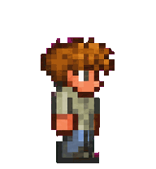
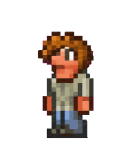

# 泰拉瑞亚向导 · Terraria Guide Pet

以《泰拉瑞亚》NPC 向导为原型的 **Codex v2 自定义宠物**。参考官方 Wiki 精灵造型，保留棕色块状头发、灰绿上衣、蓝色长裤和粗像素轮廓。

这是使用 AI 辅助生成、逐帧检查并整理的非官方同人宠物，包含 **9 组常规动作、16 个视线方向**。

| 待机 | 奔跑 | 跳跃 | 环视 |
| :---: | :---: | :---: | :---: |
|  |  |  |  |

## 安装

使用支持 `spriteVersionNumber: 2` 的本地宠物加载器。安装仅需要两个文件，不需要 Python、API 密钥或图像生成服务。

1. 下载本仓库：选择 **Code → Download ZIP**，然后解压。
2. 将仓库内 `pet/terraria-guide/` 文件夹复制到自己的 Codex 数据目录下的 `pets/` 文件夹。
3. 默认位置如下；若设置了 `CODEX_HOME`，则使用 `<CODEX_HOME>/pets/terraria-guide/`。

```text
Windows: %USERPROFILE%\.codex\pets\terraria-guide\
macOS / Linux: ~/.codex/pets/terraria-guide/
```

安装后的层级应为：

```text
pets/
└── terraria-guide/
    ├── pet.json
    └── spritesheet.webp
```

已有同名宠物时，先备份旧的 `terraria-guide` 文件夹，再替换两个文件。支持宠物设置的桌面端可在 **Settings → Pets → Refresh** 后选择新宠物，具体界面以当前客户端为准。[官方 Pets 说明](https://learn.chatgpt.com/docs/pets)

本文件是 **1536 × 2288 的 v2 图集**。官方网页端的上传规格目前为 1536 × 1872，因此本包不直接用于该网页上传入口；请勿仅缩放图片来转换版本。[网页上传规格](https://learn.chatgpt.com/docs/pets)

## 动作

| 状态 | 内容 | 帧数 |
| --- | --- | ---: |
| `idle` | 待机、轻微呼吸与眨眼 | 6 |
| `running-right` | 向右奔跑 | 8 |
| `running-left` | 向左奔跑 | 8 |
| `waving` | 挥手 | 4 |
| `jumping` | 下蹲、起跳、落地 | 5 |
| `failed` | 受挫、低头 | 8 |
| `waiting` | 等待输入、伸手询问 | 6 |
| `running` | 原地工作、思考 | 6 |
| `review` | 查看、轻微倾头 | 6 |
| 视线 | 顺时针环视，上、右、下、左及中间方向 | 16 |

`running` 是工作状态；实际左右移动由 `running-right` 和 `running-left` 表示。第一行另外保留一个静止视线帧。

## 文件

```text
pet/terraria-guide/     可安装的宠物文件
previews/              10 个 GIF 及动作、视线总览
docs/                   格式、制作过程、生成提示和发布说明
qa/                     去除本机路径的最终质量记录
SHA256SUMS.txt           文件完整性校验清单
THIRD_PARTY_NOTICES.md   参考来源和署名说明
LICENSE.md              权利与许可状态
```

## 验证情况

- v2 图集尺寸、帧布局和透明通道检查通过。
- 九组常规动作和十六个视线方向完成逐帧检查。
- 上、右、下、左四个主要方向通过三名独立审查者的多数票盲测。
- 已修正从待机切换到视线动作时的整体上移。

部分相邻视线变化细微，左右半圈衔接存在轻微姿态宽度变化。检查涵盖导出的图集、GIF 帧和帧时长，**尚未实测客户端内播放**。详见 [验证说明](docs/VALIDATION.md)。

## 来源与许可

角色与原始视觉设计源于 Terraria。主要造型参考：[官方 Wiki「向导」](https://terraria.wiki.gg/zh/wiki/%E5%90%91%E5%AF%BC)。成品使用 `gpt-image-2` 辅助生成，并经过透明处理、最近邻缩放、动画拼接与质量检查；不是从游戏直接导出的完整动画图集，也不保证与游戏逐像素一致。

本项目不代表 Terraria、Re-Logic 或 OpenAI 官方。完整来源见 [THIRD_PARTY_NOTICES.md](THIRD_PARTY_NOTICES.md)，许可状态见 [LICENSE.md](LICENSE.md)。

---

**English:** An unofficial, AI-assisted Terraria Guide pet in the Codex v2 sprite format. Includes nine standard animations and sixteen gaze directions. Copy `pet/terraria-guide/` into your local Codex `pets/` directory. The 1536 × 2288 atlas requires v2 support. Asset checks passed; live client playback has not been verified. See the attribution and rights notices before reuse.
